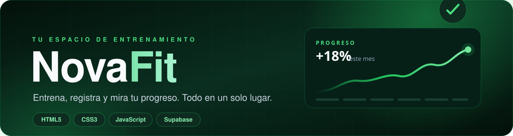

<div align="center">



<br /><br />

[](https://grey28.github.io/nova-main/)
[](https://github.com/Grey28/nova-main/actions/workflows/deploy-pages.yml)
[](#-stack)
[](#-stack)
[](#-stack)
[](#-stack)

**Una plataforma web de fitness para registrar entrenamientos, comidas y progreso, con autenticación real y un asistente que responde con tus propios datos.**

Sin frameworks. Sin build. Sin claves secretas en el navegador. 🟢

</div>

---

## ✨ Qué es NovaFit

NovaFit es un proyecto web personal pensado para acompañar el día a día del entrenamiento. Combina una **landing pública**, un **sistema de cuentas** y un **dashboard** donde cada usuario ve su rutina, su nutrición y su evolución.

Todo funciona directamente en el navegador (HTML, CSS y JavaScript puro) y usa **Supabase** como backend: autenticación, base de datos PostgreSQL con Row Level Security y almacenamiento de avatares.

> 💡 La idea: que registrar tu progreso sea tan simple que no tengas excusas para no hacerlo.

<br />

<table>
  <tr>
    <td align="center" width="25%">🏋️<br /><b>Entrena</b><br /><sub>Rutinas con nivel, duración y progreso</sub></td>
    <td align="center" width="25%">🥗<br /><b>Registra</b><br /><sub>Comidas, agua, calorías y proteína</sub></td>
    <td align="center" width="25%">📈<br /><b>Mide</b><br /><sub>Peso, constancia y entrenamientos</sub></td>
    <td align="center" width="25%">🤖<br /><b>Pregunta</b><br /><sub>Nova responde con tus datos</sub></td>
  </tr>
</table>

---

## 🚀 Demo

👉 **[https://grey28.github.io/nova-main/](https://grey28.github.io/nova-main/)**

| Página | Ruta | Descripción |
| --- | --- | --- |
| 🏠 Landing | `frontend/index.html` | Presentación de NovaFit y llamada a registrarse |
| 📝 Registro | `frontend/registro.html` | Crear cuenta con correo y contraseña |
| 🔐 Login | `frontend/inicio.html` | Iniciar sesión + asistente Nova |
| 🔁 Recuperar | `frontend/recuperar.html` | Solicitar código de recuperación |
| 🔢 Código | `frontend/codigo.html` | Verificar el código de 6 dígitos |
| 🔑 Nueva clave | `frontend/verifcodigo.html` | Establecer una contraseña nueva |
| 📊 Dashboard | `frontend/dashboard.html` | Inicio, Rutinas, Nutrición, Progreso, Comunidad y Perfil |

> La raíz del sitio redirige automáticamente a `frontend/index.html`.

---

## 🧩 Funcionalidades

### 👤 Cuenta y perfil
- Registro e inicio de sesión con **Supabase Auth**.
- Recuperación de contraseña por **código OTP** de 6 dígitos.
- Sesión persistente y rutas protegidas: sin sesión no se entra al dashboard.
- **Avatar neutro** por defecto, con opción de subir, cambiar o eliminar foto.
- Edición de nombre, objetivo, nivel y **altura (cm)**.

### 📊 Dashboard
- **Inicio:** saludo personalizado, próxima rutina, racha, meta semanal, hidratación y calorías del día.
- **Rutinas:** tarjetas por rutina con nivel, duración y botón para completarla.
- **Nutrición:** registro de comidas, agua, calorías y proteína.
- **Progreso:** peso actual, entrenamientos totales, constancia y objetivo.
- **Comunidad:** reto semanal y ranking (vista de ejemplo).
- **Mi perfil:** datos personales, objetivo, nivel, altura y avatar.

### ⚖️ Peso y primeros pasos
- Al entrar por primera vez, un modal pide **peso y altura**.
- El peso se guarda como la **primera medición** de progreso.
- La altura queda guardada en el perfil y se puede editar después.
- **Editar peso:** corrige la última medición sin crear un duplicado.
- Botón **“Ahora no”**: no vuelve a aparecer en ese navegador.

### 🤖 Nova, el asistente
- Disponible en el **login** y en el **panel de Inicio**.
- Responde sobre próxima rutina, racha, meta semanal, agua, calorías, peso, rutinas, cuenta, foto y preguntas frecuentes.
- **Sin IA externa ni API keys:** usa reglas de palabras clave y lee los datos reales del DOM.
- Incluye chips de preguntas rápidas y acciones que te llevan a la sección correcta.

---

## 🛠 Stack

| Capa | Tecnología |
| --- | --- |
| 🎨 Interfaz | HTML5 + CSS3 (Flexbox, Grid, animaciones) |
| ⚙️ Lógica | JavaScript vanilla (sin frameworks ni bundler) |
| 🔐 Auth | Supabase Auth (email + contraseña, OTP) |
| 🗄️ Datos | PostgreSQL + Row Level Security (RLS) |
| 🖼️ Archivos | Supabase Storage (bucket público `avatars`) |
| ☁️ Deploy | GitHub Actions → GitHub Pages |
| 🧩 Asistente | Reglas propias en JavaScript |

**Sin instalación de dependencias.** El SDK de Supabase se carga por CDN.

---

## 🗂 Estructura

```text
nova-main/
├── .github/
│   └── workflows/
│       └── deploy-pages.yml      # Publica en GitHub Pages
├── assets/
│   └── readme-banner.svg         # Banner de este README
├── README.md
│
└── nova-main/
    ├── index.html                # Redirige a frontend/
    ├── SUPABASE_SETUP.md         # Guía detallada de configuración
    │
    ├── frontend/
    │   ├── index.html            # Landing
    │   ├── registro.html         # Crear cuenta
    │   ├── inicio.html           # Login + Nova
    │   ├── recuperar.html        # Pedir código
    │   ├── codigo.html           # Verificar código
    │   ├── verifcodigo.html      # Nueva contraseña
    │   ├── dashboard.html        # Panel principal
    │   ├── navbar.html           # Navbar reutilizable
    │   ├── assets/
    │   │   └── avatar-placeholder.svg
    │   └── js/
    │       ├── supabase-config.js    # URL + publishable key
    │       ├── supabase-client.js    # Crea window.novaDb
    │       ├── auth.js               # Login, registro y recuperación
    │       ├── dashboard.js          # Perfil, datos y progreso
    │       └── asistente.js          # Asistente Nova
    │
    ├── style/
    │   ├── index.css
    │   ├── auth.css
    │   ├── dashboard.css
    │   ├── asistente.css
    │   └── ...
    │
    └── supabase/
        ├── schema.sql              # Tablas, RLS, trigger y Storage
        ├── profile-height.sql      # Columna height_cm (migración)
        └── storage-avatars.sql     # Bucket y políticas de avatares
```

---

## ⚡ Empezar en local

Solo necesitas un servidor HTTP local. No hay `npm install`.

```bash
# 1. Clona el repositorio
git clone https://github.com/Grey28/nova-main.git
cd nova-main/nova-main

# 2. Levanta un servidor local (Python 3)
python -m http.server 5500

# 3. Abre en el navegador
# http://localhost:5500/frontend/index.html
```

> ⚠️ **Usa siempre el mismo origen** (`localhost`, no `127.0.0.1`). Supabase guarda la sesión por origen y las URLs de redirección distinguen entre ambos.

También puedes usar la extensión **Live Server** de VS Code o cualquier servidor estático.

---

## 🗄 Configurar Supabase

La guía completa está en [`nova-main/SUPABASE_SETUP.md`](nova-main/SUPABASE_SETUP.md). Resumen:

### 1. Credenciales del frontend

Edita [`frontend/js/supabase-config.js`](nova-main/frontend/js/supabase-config.js):

```js
window.NOVAFIT_SUPABASE = {
  url: 'https://TU-PROYECTO.supabase.co',
  anonKey: 'TU-PUBLISHABLE-KEY'
};
```

> ✅ La **publishable / anon key** es pública y puede vivir en el navegador.
> ❌ **Nunca** pongas la `service_role` ni una secret key en el frontend.

### 2. Base de datos

Ejecuta en **SQL Editor**:

| Archivo | Cuándo usarlo |
| --- | --- |
| [`supabase/schema.sql`](nova-main/supabase/schema.sql) | Proyecto nuevo: tablas, RLS, trigger de perfil y bucket |
| [`supabase/profile-height.sql`](nova-main/supabase/profile-height.sql) | Si `profiles` ya existía sin la columna `height_cm` |
| [`supabase/storage-avatars.sql`](nova-main/supabase/storage-avatars.sql) | Si la subida de fotos falla con “Bucket not found” |

Tablas creadas: `profiles`, `routines`, `workouts`, `nutrition_logs` y `progress_entries`, todas protegidas con RLS (cada usuario solo ve sus filas).

### 3. URLs de autenticación

En **Authentication → URL Configuration**:

```text
Site URL:      https://grey28.github.io/nova-main/frontend/
Redirect URLs: https://grey28.github.io/nova-main/frontend/**
               http://localhost:5500/frontend/**
```

### 4. Correos (SMTP)

Supabase limita los correos integrados. Para confirmaciones y recuperación estables, configura un proveedor SMTP en **Authentication → Emails → SMTP Settings**.

> 🚧 Pendiente actual: definir el SMTP definitivo (Brevo / Gmail con contraseña de aplicación).

---

## 📦 Despliegue

Cada `push` a `main` dispara [`.github/workflows/deploy-pages.yml`](.github/workflows/deploy-pages.yml), que publica en GitHub Pages **solo**:

```text
_site/
├── frontend/
├── style/
└── index.html
```

El `README.md`, `SUPABASE_SETUP.md` y la carpeta `supabase/` **no** se publican: se quedan en el repositorio.

Para ver el estado:

```bash
gh run list --limit 5
gh run watch <RUN_ID> --exit-status
```

---

## 🔒 Seguridad

- 🔑 El frontend solo usa la **publishable key**; la seguridad real vive en **RLS**.
- 🚫 Nunca se sube `service_role` ni secretos al repositorio.
- 🧱 Cada tabla filtra por `auth.uid()`: un usuario no puede leer ni escribir datos de otro.
- 🖼️ Las políticas de Storage limitan escritura a la carpeta del propio usuario.
- 🌐 Las URLs de redirección están restringidas al dominio de producción y a `localhost`.

---

## 🧠 Cómo funciona Nova (sin IA)

Nova no llama a ningún modelo externo. El flujo es sencillo:

```text
Tu pregunta
   ↓
Normalizar texto (minúsculas, sin acentos)
   ↓
Puntuar palabras clave por tema
   ↓
Leer datos reales del dashboard (DOM)
   ↓
Elegir la mejor respuesta + acciones
```

Esto la hace **gratis, instantánea, privada y compatible con GitHub Pages**. Si la pregunta no coincide con ninguna regla, ofrece una respuesta de ayuda con las opciones disponibles.

---

## 📚 Guía de estudio

¿Quieres entender cómo está construido el proyecto? La guía recorre los archivos uno por uno, explica los conceptos desde cero, muestra los flujos de datos y propone ejercicios:

👉 **[docs/GUIA-ESTUDIO.md](docs/GUIA-ESTUDIO.md)**

---

## 🗺 Roadmap

- [x] Autenticación completa con Supabase
- [x] Dashboard con datos reales y RLS
- [x] Avatar con placeholder neutro
- [x] Asistente Nova basado en reglas
- [x] Onboarding de peso y altura
- [x] Edición del peso registrado
- [ ] Subida de avatares en producción (ejecutar `storage-avatars.sql`)
- [ ] SMTP definitivo para correos de confirmación
- [ ] Comunidad real (retos y ranking conectados a la base de datos)
- [ ] Historial y gráfica de progreso
- [ ] Exportar datos personales

---

## 🤝 Contribuir

Este es un proyecto personal de aprendizaje, pero las ideas y correcciones son bienvenidas.

1. Haz un fork del repositorio.
2. Crea una rama: `git checkout -b feature/mi-mejora`.
3. Haz tus cambios y prueba el flujo en local.
4. Abre un Pull Request describiendo qué mejora y por qué.

Si encuentras un bug, abre un **issue** con los pasos para reproducirlo y una captura si es posible.

---

<div align="center">

### 🌱 Hecho con constancia, café y muchas ganas de mejorar.

**NovaFit** · Entrena, registra y mira tu progreso.

[⬆ Volver arriba](#) · [🌐 Ver el sitio](https://grey28.github.io/nova-main/) · [🐛 Reportar un problema](https://github.com/Grey28/nova-main/issues)

<sub>Proyecto personal sin fines comerciales. Las marcas y nombres pertenecen a sus respectivos dueños.</sub>

</div>
