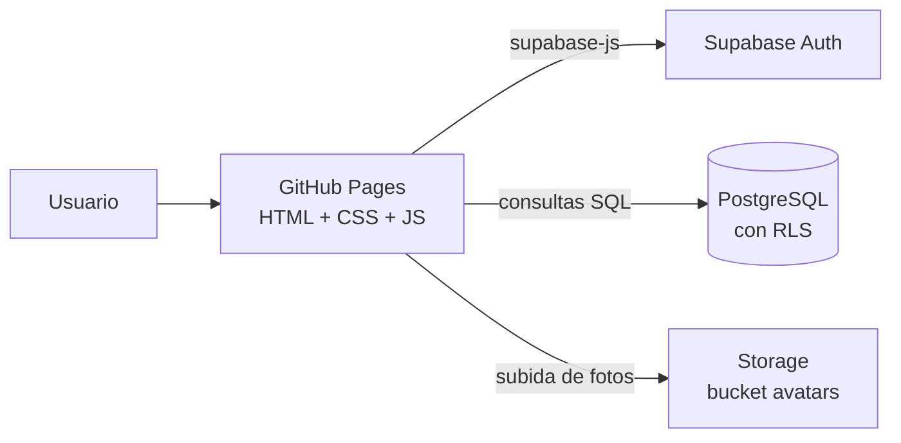
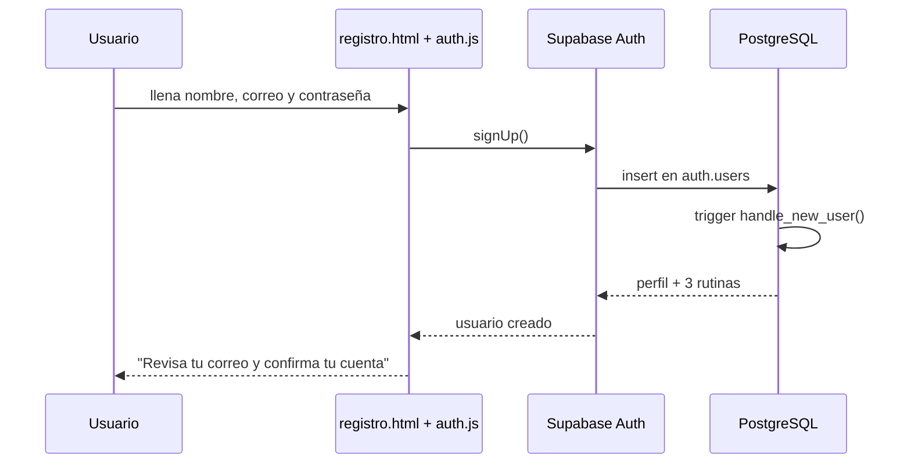
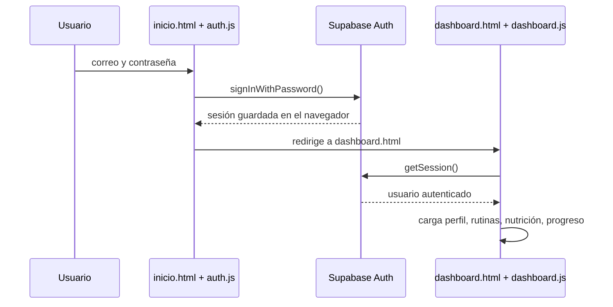
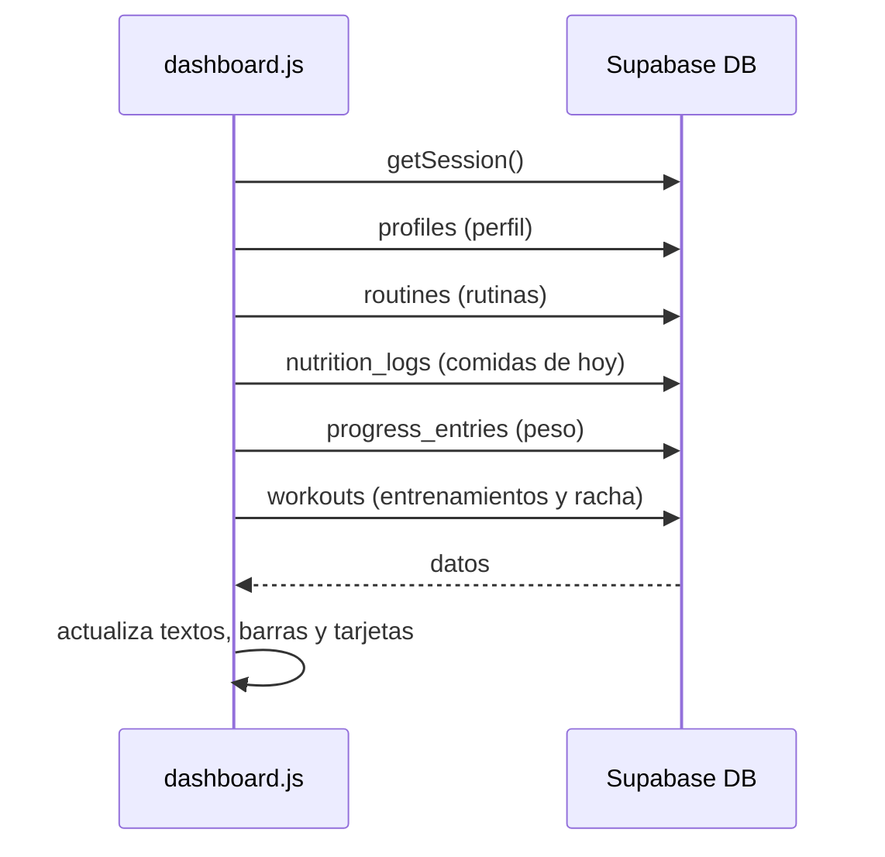

# Guía de estudio de NovaFit

> Guía para aprender leyendo el código real del proyecto.
> Pensada para alguien que ya entiende lo básico de HTML y CSS, y que está empezando con JavaScript y Supabase.

---

## Índice

1. [Cómo usar esta guía](#1-cómo-usar-esta-guía)
2. [Vista general del proyecto](#2-vista-general-del-proyecto)
3. [Mapa de archivos](#3-mapa-de-archivos)
4. [Ocho conceptos que necesitas antes de empezar](#4-ocho-conceptos-que-necesitas-antes-de-empezar)
5. [Cómo ejecutar el proyecto en tu computador](#5-cómo-ejecutar-el-proyecto-en-tu-computador)
6. [Recorrido archivo por archivo](#6-recorrido-archivo-por-archivo)
7. [Flujos explicados paso a paso](#7-flujos-explicados-paso-a-paso)
8. [Seguridad: lo más importante](#8-seguridad-lo-más-importante)
9. [Cómo está organizado el CSS](#9-cómo-está-organizado-el-css)
10. [Caso de estudio: el perfil falso que aparecía al recargar](#10-caso-de-estudio-el-perfil-falso-que-aparecía-al-recargar)
11. [Ejercicios para practicar](#11-ejercicios-para-practicar)
12. [Plan de estudio de 7 días](#12-plan-de-estudio-de-7-días)
13. [Autoevaluación](#13-autoevaluación)
14. [Glosario](#14-glosario)
15. [Dónde mirar cuando algo falla](#15-dónde-mirar-cuando-algo-falla)

---

## 1. Cómo usar esta guía

No leas la guía como una novela. Úsala así:

1. Ten el proyecto abierto en tu editor (recomendado: **VS Code**).
2. Ten el sitio corriendo en el navegador.
3. Lee una sección y, al mismo tiempo, abre el archivo que se menciona.
4. Cuando veas una función, búscala con `Ctrl + F` dentro del archivo.
5. Haz los ejercicios: son la parte que realmente enseña.

### Convenciones

| Símbolo | Significado |
| --- | --- |
| 📄 | Archivo que debes abrir |
| 💡 | Concepto importante |
| 🔎 | Algo que conviene observar con calma |
| ✍️ | Ejercicio práctico |
| ⚠️ | Error común o cuidado de seguridad |

### Herramientas que vas a usar

- **Navegador** (Chrome o Edge).
- **DevTools**: se abre con `F12` o `Ctrl + Shift + I`.
  - Pestaña **Elements**: ver el HTML real.
  - Pestaña **Console**: ver errores y mensajes.
  - Pestaña **Network**: ver las peticiones a Supabase.
  - Pestaña **Application**: ver `localStorage` y la sesión.
- **VS Code**: editor de código.
- **Terminal**: para levantar el servidor local.

💡 **Truco para estudiar:** en DevTools, pestaña **Sources**, puedes poner un *breakpoint* (clic en el número de línea) y ver cómo se ejecuta el código paso a paso.

---

## 2. Vista general del proyecto

NovaFit es una aplicación web de fitness con tres partes:

1. **Landing pública:** presenta el producto.
2. **Pantallas de cuenta:** registro, login y recuperación de contraseña.
3. **Dashboard:** rutinas, nutrición, progreso, perfil y un asistente virtual.

La parte importante: **no hay servidor propio ni proceso de build**. Todo el frontend son archivos HTML, CSS y JavaScript que el navegador descarga tal cual. La base de datos, la autenticación y las fotos viven en **Supabase**.

### Arquitectura



### Qué significa esto en la práctica

- No necesitas `npm install` ni `npm run build`.
- Para probar cambios solo recargas el navegador.
- El "backend" es Supabase: tú escribes consultas desde JavaScript.
- GitHub Pages publica automáticamente lo que está en `main`.

---

## 3. Mapa de archivos

La raíz del repositorio tiene una carpeta interna que también se llama `nova-main/`. Es un poco confuso, pero es así:

```text
nova-main/                      ← raíz del repositorio
├── .github/workflows/
│   └── deploy-pages.yml        ← publica el sitio en GitHub Pages
├── assets/                     ← imágenes del README
├── docs/
│   └── GUIA-ESTUDIO.md         ← esta guía
├── nova-main/                  ← carpeta interna con el sitio
│   ├── index.html              ← redirige a frontend/index.html
│   ├── frontend/
│   │   ├── index.html          ← landing
│   │   ├── inicio.html         ← login
│   │   ├── registro.html       ← crear cuenta
│   │   ├── recuperar.html      ← pedir código
│   │   ├── codigo.html         ← verificar código
│   │   ├── verifcodigo.html    ← nueva contraseña
│   │   ├── dashboard.html      ← panel privado
│   │   ├── navbar.html         ← demo de navbar
│   │   ├── assets/             ← favicon y avatar por defecto
│   │   └── js/
│   │       ├── supabase-config.js
│   │       ├── supabase-client.js
│   │       ├── auth.js
│   │       ├── dashboard.js
│   │       └── asistente.js
│   ├── style/
│   │   ├── theme.css           ← variables y base visual
│   │   ├── index.css           ← landing
│   │   ├── auth-pages.css      ← pantallas de cuenta
│   │   ├── auth.css            ← mensajes y toasts
│   │   ├── dashboard.css       ← dashboard
│   │   ├── asistente.css       ← chat de Nova
│   │   └── navbar.css          ← navbar de demo
│   └── supabase/
│       ├── schema.sql          ← tablas, RLS y triggers
│       ├── profile-height.sql  ← migración de altura
│       └── storage-avatars.sql ← bucket y permisos de fotos
├── README.md
└── SUPABASE_SETUP.md
```

### Tabla rápida: ¿qué archivo tocar?

| Quiero… | Archivo |
| --- | --- |
| Cambiar colores o tipografía | `style/theme.css` |
| Cambiar la landing | `frontend/index.html` + `style/index.css` |
| Cambiar el login o registro | `frontend/inicio.html` / `registro.html` + `style/auth-pages.css` |
| Cambiar la lógica de sesión | `frontend/js/auth.js` |
| Cambiar el dashboard | `frontend/dashboard.html` + `style/dashboard.css` |
| Cambiar la lógica del dashboard | `frontend/js/dashboard.js` |
| Añadir respuestas a Nova | `frontend/js/asistente.js` |
| Cambiar la base de datos | `supabase/schema.sql` |
| Cambiar el despliegue | `.github/workflows/deploy-pages.yml` |

---

## 4. Ocho conceptos que necesitas antes de empezar

Si algo de esto no lo tienes claro, no pasa nada: aquí está explicado con ejemplos del propio proyecto.

### 4.1 HTML: `id` y `class`

- `id` identifica **un** elemento. Se usa para encontrarlo desde JavaScript.
- `class` agrupa elementos para darles estilo.

Ejemplo del dashboard:

```html
<div class="card">
  <h3>Racha actual 🔥</h3>
  <div class="metric" id="streakMetric">—</div>
</div>
```

- `card` y `metric` son clases: definen el diseño.
- `streakMetric` es un `id`: `dashboard.js` lo busca con `$('streakMetric')` y cambia su texto.

🔎 **Regla mental:** el CSS normalmente usa clases; el JavaScript normalmente usa ids.

### 4.2 CSS: variables (custom properties)

En `style/theme.css` están los colores del proyecto:

```css
:root {
    --nf-bg: #08080b;
    --nf-lime: #d8ff3e;
    --nf-text: #f5f5f7;
}
```

Luego se usan así:

```css
body {
    background: var(--nf-bg);
    color: var(--nf-text);
}
```

💡 Cambiar `--nf-lime` cambia el acento en **todo** el sitio. Ese es el poder de las variables.

### 4.3 CSS: Flexbox y Grid

- **Flexbox** alinea elementos en una fila o columna.
- **Grid** crea columnas y filas.

Ejemplo de Grid en el dashboard:

```css
.layout {
    display: grid;
    grid-template-columns: 252px minmax(0, 1fr);
}
```

Esto significa: una columna de 252 px para el menú lateral y otra que ocupa el resto.

### 4.4 JavaScript: el DOM

El DOM es el árbol de elementos de la página. JavaScript lo lee y lo modifica.

```js
var $ = function (id) { return document.getElementById(id); };

$('profileName').textContent = name;
```

- `getElementById` busca un elemento por su `id`.
- `textContent` cambia el texto visible.
- `style.width` cambia estilos.
- `classList.add/remove` añade o quita clases.

### 4.5 JavaScript: eventos

Un evento es algo que ocurre: un clic, un envío de formulario, un cambio de archivo.

```js
form.addEventListener('submit', async function (event) {
    event.preventDefault();
    // ...
});
```

- `submit` es el evento.
- `event.preventDefault()` evita que el formulario recargue la página.
- `async` permite usar `await` dentro.

### 4.6 JavaScript: promesas y `async/await`

Las consultas a Supabase tardan. No son instantáneas. Por eso son **asíncronas**.

```js
var result = await db.auth.signInWithPassword({
    email: email,
    password: password
});
```

- `await` significa: "espera el resultado antes de seguir".
- `result.error` contiene el error si algo falló.
- `result.data` contiene los datos si todo salió bien.

### 4.7 IIFE: funciones que se ejecutan solas

Muchos archivos empiezan así:

```js
(function () {
    'use strict';
    // código
})();
```

Es una **IIFE** (*Immediately Invoked Function Expression*). Sirve para crear un espacio privado: las variables de adentro no ensucian el resto de la página.

### 4.8 Supabase: Auth, base de datos y Storage

- **Auth**: registra e inicia sesión. Guarda la sesión en el navegador.
- **Base de datos**: PostgreSQL. Se consulta con `db.from('tabla')...`.
- **Storage**: guarda archivos, en este caso las fotos de perfil.

Ejemplo de consulta:

```js
var result = await db.from('profiles')
    .select('*')
    .eq('id', currentUser.id)
    .maybeSingle();
```

Se lee así: "de la tabla `profiles`, selecciona todo, donde `id` sea igual al id del usuario actual, y devuelve una sola fila o nada".

---

## 5. Cómo ejecutar el proyecto en tu computador

### Paso 1: clonar (si aún no lo tienes)

```bash
git clone https://github.com/Grey28/nova-main.git
cd nova-main
```

### Paso 2: entrar a la carpeta interna

```bash
cd nova-main
```

Sí, otra vez `nova-main`. Es la carpeta que contiene `frontend/`, `style/` y `supabase/`.

### Paso 3: levantar un servidor local

```bash
python -m http.server 5500 --bind 127.0.0.1
```

Deja esa terminal abierta.

### Paso 4: abrir en el navegador

```text
http://127.0.0.1:5500/frontend/
```

⚠️ Usa `127.0.0.1`, no `localhost`. El servidor está atado a esa dirección y `localhost` a veces intenta IPv6.

### ¿Por qué no abrir el HTML con doble clic?

Porque el navegador lo abriría como `file://...`, y Supabase Auth necesita un origen `http://` para guardar la sesión y redirigir. Con doble clic, el login no funciona bien.

---

## 6. Recorrido archivo por archivo

Este es el corazón de la guía. Lee en el orden propuesto.

### 6.1 `nova-main/index.html`

📄 Ruta: `nova-main/index.html`

Es un archivo muy corto. Solo redirige:

```html
<meta http-equiv="refresh" content="0; url=frontend/index.html">
```

💡 **Concepto:** redirección con HTML. El sitio publicado en `https://grey28.github.io/nova-main/` entra aquí y salta a `frontend/index.html`.

🔎 Observa que también tiene el favicon con rutas relativas a `frontend/assets/`.

---

### 6.2 La landing: `frontend/index.html`

📄 Ruta: `nova-main/frontend/index.html`

La landing está dividida en secciones semánticas:

```html
<header class="site-header">...</header>
<main>
    <section class="hero" id="inicio">...</section>
    <section class="section split" id="que-es">...</section>
    <section class="section" id="funciones">...</section>
    ...
</main>
<footer class="site-footer">...</footer>
```

🔎 **Qué mirar:**

1. **Header fijo:** `site-header` se queda arriba al hacer scroll.
2. **Hero:** título grande, botones y un mock del dashboard hechas con HTML y CSS (no es una imagen).
3. **Enlaces internos:** `href="#funciones"` salta a la sección con `id="funciones"`.
4. **Acordeón de preguntas frecuentes:** al final hay un `<script>` pequeño:

```js
const accordion = document.querySelectorAll(".accordion");

accordion.forEach(item => {
    item.addEventListener("click", function () {
        this.classList.toggle("active");
        const panel = this.nextElementSibling;

        if (panel.style.maxHeight) {
            panel.style.maxHeight = null;
        } else {
            panel.style.maxHeight = panel.scrollHeight + "px";
        }
    });
});
```

💡 **Concepto:** `nextElementSibling` obtiene el siguiente elemento hermano (el panel de respuesta). Se anima cambiando `maxHeight`.

✍️ **Ejercicio mental:** ¿por qué se usa `scrollHeight` y no un valor fijo como `200px`? Porque cada respuesta tiene una altura distinta.

### `style/index.css`

📄 Ruta: `nova-main/style/index.css`

Aquí está todo el diseño de la landing: header, hero, tarjetas, planes, FAQ, footer y responsive.

🔎 Busca `@media` al final. Cada bloque aplica estilos solo cuando la pantalla es más pequeña que cierto ancho:

```css
@media (max-width: 1080px) { ... }
@media (max-width: 760px) { ... }
```

💡 **Concepto:** *mobile first vs desktop first*. Este proyecto usa *desktop first*: diseña para escritorio y luego corrige en pantallas pequeñas.

---

### 6.3 Las pantallas de cuenta

Archivos HTML:

- `frontend/inicio.html` → login.
- `frontend/registro.html` → crear cuenta.
- `frontend/recuperar.html` → pedir código.
- `frontend/codigo.html` → escribir el código de 6 dígitos.
- `frontend/verifcodigo.html` → nueva contraseña.

Todas comparten el mismo estilo:

```html
<link rel="stylesheet" href="../style/theme.css">
<link rel="stylesheet" href="../style/auth-pages.css">
<link rel="stylesheet" href="../style/auth.css">
```

Y todas tienen un atributo especial en el `<body>`:

```html
<body data-page="login">
```

💡 **Concepto:** `data-page` es un atributo personalizado. `auth.js` lo lee para saber qué formulario debe activar.

🔎 **Qué mirar en `auth-pages.css`:**

- `.auth-card`: la tarjeta central.
- `.auth-brand`: el logo.
- `.codigo input`: las cajas del código OTP.
- El `@media (max-width: 480px)` ajusta tamaños en móvil.

### `frontend/js/auth.js`

📄 Ruta: `nova-main/frontend/js/auth.js`

Es el archivo más importante para entender la autenticación. Empieza con una IIFE y lee la página actual:

```js
var page = document.body.getAttribute('data-page');
```

Luego tiene una función por pantalla:

| Función | Página | Qué hace |
| --- | --- | --- |
| `initLogin()` | login | `signInWithPassword` |
| `initRegister()` | registro | `signUp` |
| `initRecover()` | recuperar | `resetPasswordForEmail` |
| `initCode()` | código | `verifyOtp` con tipo `recovery` |
| `initReset()` | nueva contraseña | `updateUser` |

Y al final elige cuál ejecutar:

```js
var initializers = {
    login: initLogin,
    register: initRegister,
    recover: initRecover,
    'verify-code': initCode,
    'reset-password': initReset
};

var initialize = initializers[page];
if (typeof initialize === 'function') initialize();
```

💡 **Concepto:** objeto como "tabla de funciones". En vez de muchos `if`, se busca la función por nombre.

🔎 **Detalles que enseñan mucho:**

1. **Traducción de errores:** `translateError()` convierte mensajes de Supabase en español.
2. **Estado de carga:** `setLoading()` desactiva el botón y cambia su texto mientras espera.
3. **Redirección si ya hay sesión:** `redirectIfLoggedIn()` evita que un usuario logueado vea el login otra vez.
4. **Código OTP:** `initCode()` maneja escritura, borrado y pegado de los 6 dígitos.
5. **Recuperación:** el correo se guarda temporalmente en `sessionStorage` para usarlo en la pantalla del código.

✍️ **Ejercicio de lectura:** busca `requireSupabase()` y explica con tus palabras qué hace y por qué se llama al principio.

---

### 6.4 La conexión con Supabase

#### `frontend/js/supabase-config.js`

📄 Ruta: `nova-main/frontend/js/supabase-config.js`

Solo tiene dos datos:

```js
window.NOVAFIT_SUPABASE = {
    url: 'https://...supabase.co',
    anonKey: 'sb_publishable_...'
};
```

⚠️ **Seguridad:** esta clave es **pública** y está diseñada para ir en el navegador. Lo que **nunca** debe ir aquí es la `service_role` o cualquier clave secreta.

#### `frontend/js/supabase-client.js`

📄 Ruta: `nova-main/frontend/js/supabase-client.js`

Hace tres cosas:

1. Verifica que la configuración no tenga valores de ejemplo.
2. Verifica que el SDK de Supabase se haya cargado desde el CDN.
3. Crea el cliente y lo expone como `window.novaDb`.

```js
window.novaDb = window.supabase.createClient(config.url, config.anonKey, {
    auth: {
        persistSession: true,
        autoRefreshToken: true,
        detectSessionInUrl: true
    }
});
```

💡 **Concepto:** `persistSession: true` hace que la sesión sobreviva al recargar la página. Supabase la guarda en el navegador.

También calcula la URL base del frontend:

```js
window.NOVAFIT_BASE_URL = new URL('.', window.location.href).href;
```

Se usa para los enlaces de confirmación de correo.

---

### 6.5 El dashboard: HTML

📄 Ruta: `nova-main/frontend/dashboard.html`

Es una sola página con varias secciones. Solo una se muestra a la vez:

```html
<section id="inicio" class="app-section">...</section>
<section id="rutinas" class="app-section">...</section>
<section id="nutricion" class="app-section">...</section>
<section id="progreso" class="app-section">...</section>
<section id="comunidad" class="app-section">...</section>
<section id="perfil" class="app-section">...</section>
```

El script del final decide cuál mostrar según el hash de la URL:

```js
function showSection() {
    const id = (location.hash || '#inicio').slice(1);
    const target = document.getElementById(id) ? id : 'inicio';

    sections.forEach(s => s.classList.toggle('active', s.id === target));
    links.forEach(a => a.classList.toggle('active', a.dataset.section === target));
}
```

💡 **Concepto:** navegación por *hash*. `dashboard.html#progreso` muestra la sección de progreso sin recargar.

🔎 **Qué mirar:**

- Los `id` de las métricas (`streakMetric`, `weightMetric`, etc.). `dashboard.js` los usa.
- El modal de onboarding (`onboardingModal`).
- Los formularios del perfil (`profileNameInput`, `profileHeightInput`, etc.).
- La clase `is-booting` en el `<body>`: oculta datos personales hasta que se cargan los reales.

### 6.6 El dashboard: `frontend/js/dashboard.js`

📄 Ruta: `nova-main/frontend/js/dashboard.js`

Es el archivo más largo y el que más enseña sobre aplicaciones reales.

#### Estructura general

```js
(function () {
    'use strict';

    var db = window.novaDb;
    var $ = function (id) { return document.getElementById(id); };

    var currentUser = null;
    // ...

    async function init() {
        // 1. comprobar sesión
        // 2. conectar botones
        // 3. cargar datos
    }

    init();
})();
```

#### `init()`: el punto de entrada

🔎 Búscalo cerca del final del archivo. Hace esto:

1. Comprueba que Supabase esté configurado.
2. Pide la sesión con `db.auth.getSession()`.
3. Si no hay sesión, redirige a `inicio.html`.
4. Guarda el usuario en `currentUser`.
5. Conecta los botones y formularios.
6. Carga todos los datos con `Promise.all`:

```js
await Promise.all([
    loadProfile(),
    loadRoutines(),
    loadNutrition(),
    loadProgress(),
    loadSummary()
]);
```

💡 **Concepto:** `Promise.all` lanza varias tareas asíncronas al mismo tiempo y espera a que terminen todas. Es más rápido que una por una.

#### `loadProfile()`

Busca el perfil en la tabla `profiles`. Si no existe, lo crea con los datos del registro. Luego actualiza el DOM:

```js
$('profileName').textContent = name;
$('heroName').textContent = name.split(' ')[0];
$('profilePlan').textContent = profile.level || 'Miembro';
$('profileNameInput').value = name;
$('profileEmailInput').value = currentUser.email || '';
$('avatarImg').src = avatarUrl;
```

🔎 Observa el detalle: `name.split(' ')[0]` toma solo el primer nombre para el saludo.

#### `loadSummary()`

Calcula las métricas de la pantalla Inicio:

- **Racha:** días consecutivos con entrenamiento.
- **Entrenamientos del mes:** cuenta las filas de `workouts`.
- **Meta semanal:** entrenamientos desde el lunes, con meta de 4.
- **Hidratación:** suma `water_l` del día.
- **Constancia:** porcentaje aproximado del mes.
- **Próxima rutina:** la primera rutina ordenada por progreso.

La racha se calcula con un `Set` de fechas:

```js
var doneDays = new Set(workouts.map(function (row) {
    return localDateISO(new Date(row.completed_at));
}));

var streak = 0;
var cursor = new Date(now.getFullYear(), now.getMonth(), now.getDate());

while (doneDays.has(localDateISO(cursor))) {
    streak += 1;
    cursor.setDate(cursor.getDate() - 1);
}
```

💡 **Concepto:** un `Set` guarda valores únicos. `has()` responde si una fecha ya está en el conjunto.

#### `loadRoutines()`

Consulta las rutinas y genera tarjetas con HTML. Cada tarjeta tiene un botón con `data-routine-id`.

🔎 **Detalle de seguridad:** el nombre de la rutina se escapa con `escapeHtml()` antes de insertarlo:

```js
'<h3>' + escapeHtml(routine.name) + '</h3>'
```

⚠️ **Concepto:** esto evita **XSS** (inyección de HTML). Si un usuario pudiera guardar `<script>` como nombre de rutina, se ejecutaría en el navegador de otro. Escapar lo convierte en texto seguro.

#### `completeRoutine()`

Cuando pulsas "Comenzar":

1. Inserta una fila en `workouts`.
2. Suma 25 al progreso de la rutina.
3. Recarga rutinas, resumen y progreso.

#### `loadNutrition()` y `bindMealButton()`

- `loadNutrition()` suma calorías, proteína y agua del día.
- `bindMealButton()` pide datos con `window.prompt()` y guarda una comida.
- En una app real, cambiarías los `prompt()` por un formulario modal.

#### `loadProgress()` y `bindWeightEdit()`

- `loadProgress()` trae la primera y la última medición de peso, calcula la diferencia y muestra el total de entrenamientos.
- `bindWeightEdit()` actualiza la **última** medición existente, no crea una nueva.

#### Onboarding

`maybeShowOnboarding()` comprueba:

- Si el usuario ya pidió "Ahora no" (`localStorage`), no muestra nada.
- Si ya tiene altura y al menos una medición, no muestra nada.
- Si le falta algo, abre el modal para pedir peso y altura.

💡 **Concepto:** `localStorage` guarda datos en el navegador y no expira. Se usa para recordar que el usuario omitió el onboarding.

#### Avatar

`bindAvatarControls()`:

1. Valida que el archivo sea JPG, PNG o WebP.
2. Valida que pese máximo 2 MB.
3. Sube a Storage con la ruta `idDelUsuario/avatar.ext`.
4. Obtiene la URL pública.
5. Guarda esa URL en `profiles.avatar_url`.

🔎 La ruta incluye el id del usuario porque las políticas de Storage exigen que la primera carpeta sea el id.

---

### 6.7 El asistente: `frontend/js/asistente.js`

📄 Ruta: `nova-main/frontend/js/asistente.js`

Nova **no usa inteligencia artificial externa**. Es un motor de reglas.

#### Cómo lee los datos

```js
function context() {
    return {
        dashboard: isDashboard(),
        name: textOf('heroName') || textOf('profileName'),
        nextRoutine: textOf('nextRoutineText'),
        streak: textOf('streakMetric'),
        workoutsMonth: textOf('workoutsMetric'),
        weeklyGoal: textOf('weeklyGoalMetric'),
        hydration: textOf('hydrationMetric'),
        calories: textOf('caloriesMetric'),
        protein: textOf('proteinMetric'),
        weight: textOf('weightMetric'),
        totalWorkouts: textOf('totalWorkoutsMetric'),
        routines: routinesList()
    };
}
```

💡 **Concepto:** el asistente no consulta la base de datos. Lee lo que ya está escrito en la pantalla. Por eso solo funciona bien dentro del dashboard.

#### Cómo elige una respuesta

```js
var RULES = [
    { keys: ['racha', 'dias seguidos'], answer: answerStreak },
    { keys: ['peso', 'balanza', 'medicion'], answer: answerWeight },
    // ...
];
```

1. Normaliza el texto: minúsculas, sin tildes y sin signos.
2. Recorre todas las reglas.
3. Suma la longitud de cada palabra clave encontrada.
4. La regla con mayor puntaje gana.

```js
for (var j = 0; j < rule._keys.length; j++) {
    if (text.indexOf(rule._keys[j]) !== -1) score += rule._keys[j].length;
}
```

💡 **Concepto:** puntuación por coincidencia. Una frase larga y específica gana sobre una palabra corta y genérica.

#### Cómo construye la interfaz

`build()` crea todo el HTML del chat con `document.createElement` e `innerHTML`, y lo inserta en la página. Por eso el asistente se puede cargar en el login y en el dashboard sin duplicar HTML.

✍️ **Ejercicio:** añade una regla nueva para "¿cómo cambio mi foto?" si no existiera, y observa cómo `answerAvatar` responde con datos distintos según la página.

---

### 6.8 La base de datos: `supabase/schema.sql`

📄 Ruta: `nova-main/supabase/schema.sql`

Define cinco tablas:

| Tabla | Para qué |
| --- | --- |
| `profiles` | nombre, objetivo, nivel, altura, avatar |
| `routines` | rutinas de cada usuario |
| `workouts` | entrenamientos completados |
| `nutrition_logs` | comidas, calorías, proteína y agua |
| `progress_entries` | peso y grasa corporal a lo largo del tiempo |

#### RLS: Row Level Security

Cada tabla tiene RLS activado:

```sql
alter table public.profiles enable row level security;

create policy "profiles_own" on public.profiles
    for all
    using (auth.uid() = id)
    with check (auth.uid() = id);
```

💡 **Concepto:** `auth.uid()` es el id del usuario autenticado. La política dice: "solo puedes ver y modificar filas cuyo dueño seas tú". Esto se aplica **en la base de datos**, no en el navegador. Aunque alguien modifique el JavaScript, no puede leer datos de otros.

#### Trigger de registro

`handle_new_user()` se ejecuta automáticamente cuando se crea un usuario en `auth.users`:

1. Crea su fila en `profiles`.
2. Le inserta tres rutinas iniciales.

```sql
create trigger on_auth_user_created
    after insert on auth.users
    for each row
    execute function public.handle_new_user();
```

💡 **Concepto:** un *trigger* es código SQL que se ejecuta solo cuando ocurre un evento (en este caso, un `insert`).

#### Storage

El bucket `avatars` es público para lectura. Para escribir, la política exige que la carpeta coincida con el id del usuario:

```sql
(storage.foldername(name))[1] = auth.uid()::text
```

Así nadie puede subir fotos a la carpeta de otra persona.

### `supabase/profile-height.sql` y `storage-avatars.sql`

Son migraciones pequeñas para agregar la columna `height_cm` y el bucket de avatares a una base que ya existía.

---

### 6.9 El despliegue: `.github/workflows/deploy-pages.yml`

📄 Ruta: `.github/workflows/deploy-pages.yml`

Se ejecuta cuando haces `push` a `main`:

```yaml
on:
  push:
    branches: [main]
```

Luego:

1. Copia `nova-main/frontend`, `nova-main/style` y `nova-main/index.html` a una carpeta `_site`.
2. Sube `_site` como artefacto.
3. GitHub Pages lo publica.

💡 **Concepto:** GitHub Actions es automatización. Tú haces `git push` y el flujo construye y publica el sitio solo.

🔎 **Detalle:** `docs/` no se publica. La guía solo se ve en GitHub, no en el sitio.

---

## 7. Flujos explicados paso a paso

### 7.1 Registro



🔎 Archivos: `registro.html`, `auth.js` (`initRegister`), `schema.sql` (`handle_new_user`).

### 7.2 Login y entrada al dashboard



🔎 Archivos: `auth.js` (`initLogin`), `dashboard.js` (`init`).

### 7.3 Carga del dashboard



🔎 Las cinco consultas se lanzan en paralelo con `Promise.all`.

### 7.4 Guardar el perfil

1. El usuario cambia nombre, objetivo, nivel o altura.
2. `bindProfileForm()` valida.
3. `db.from('profiles').upsert(...)` crea o actualiza la fila.
4. Se recargan perfil y resumen.

💡 `upsert` significa "inserta si no existe, actualiza si existe".

### 7.5 Subir una foto

1. El usuario elige un archivo.
2. Se valida tipo y tamaño.
3. Se sube a `avatars/<id>/avatar.ext`.
4. Se obtiene la URL pública.
5. Se guarda en `profiles.avatar_url`.
6. Se actualiza la imagen del navbar y del perfil.

### 7.6 Onboarding

1. Al cargar el dashboard, `maybeShowOnboarding()` revisa altura y mediciones.
2. Si faltan, abre el modal.
3. Al guardar: actualiza `profiles.height_cm` e inserta el peso en `progress_entries` si es la primera vez.
4. "Ahora no" guarda una marca en `localStorage`.

### 7.7 Respuesta de Nova

1. El usuario escribe una pregunta.
2. `normalize()` limpia el texto.
3. `findAnswer()` puntúa todas las reglas.
4. La respuesta se construye con `context()` (datos del DOM).
5. Se inserta un mensaje en el panel del chat.

---

## 8. Seguridad: lo más importante

### 8.1 Clave pública vs clave secreta

| Clave | ¿Puede ir en el frontend? | Para qué |
| --- | --- | --- |
| `anon` / `publishable` | ✅ Sí | Identifica el proyecto; los permisos reales los pone RLS |
| `service_role` | ❌ Nunca | Salta RLS; da acceso total a la base |

⚠️ Si alguna vez pegas una `service_role` en el código, cualquiera puede leer y borrar toda la base. Si eso pasa, hay que rotarla de inmediato.

### 8.2 RLS es la verdadera protección

La validación en JavaScript (por ejemplo, "el peso debe ser positivo") mejora la experiencia, pero se puede saltar. La protección real está en las políticas de la base de datos.

### 8.3 Escapar HTML

Siempre que insertes datos de usuario con `innerHTML`, usa `escapeHtml()`:

```js
function escapeHtml(value) {
    return String(value == null ? '' : value)
        .replace(/&/g, '&amp;')
        .replace(/</g, '&lt;')
        .replace(/>/g, '&gt;')
        .replace(/"/g, '&quot;')
        .replace(/'/g, '&#39;');
}
```

### 8.4 La sesión

Supabase guarda la sesión en el navegador. Cualquier persona con acceso físico a ese navegador podría usarla. Por eso:

- No uses equipos compartidos para cuentas importantes.
- Cierra sesión cuando termines.
- En producción, considera expiración de sesión más corta.

---

## 9. Cómo está organizado el CSS

### 9.1 `theme.css`: la base

Contiene:

- Variables de color, radios, sombras y tipografía.
- Estilos base de `body`, títulos, enlaces y botones.
- Scrollbar y selección de texto.

Para cambiar el tema, edita solo las variables:

```css
:root {
    --nf-lime: #d8ff3e;
    --nf-bg: #08080b;
    --nf-surface: #111117;
    --nf-font-body: 'Inter', sans-serif;
}
```

### 9.2 Un CSS por pantalla

| Archivo | Alcance |
| --- | --- |
| `index.css` | landing |
| `auth-pages.css` | login, registro, recuperar, código, nueva contraseña |
| `dashboard.css` | dashboard |
| `asistente.css` | chat de Nova |
| `navbar.css` | demo de navbar |
| `auth.css` | mensajes de error y toasts |

💡 **Ventaja:** cada pantalla carga solo lo que necesita. **Desventaja:** algunos estilos se repiten. Para un proyecto pequeño es un buen equilibrio.

### 9.3 Responsive

Los breakpoints más usados:

- `1080px`: la landing pasa a una columna.
- `980px`: se oculta el menú de navegación de la landing.
- `860px`: planes y pasos en una columna.
- `760px`: el sidebar del dashboard se vuelve un menú deslizante.
- `640px` / `520px` / `480px`: ajustes de móvil.

### 9.4 Estados de carga

El dashboard usa la clase `is-booting` en el `<body>`:

```css
body.is-booting .profile-info,
body.is-booting #heroGreeting {
    visibility: hidden;
}
```

Cuando `loadProfile()` termina, `dashboard.js` quita la clase:

```js
document.body.classList.remove('is-booting');
```

💡 **Concepto:** mostrar un estado de carga es mejor que mostrar datos falsos.

---

## 10. Caso de estudio: el perfil falso que aparecía al recargar

Este es un excelente ejemplo de algo que pasa en proyectos reales.

### El problema

Al recargar el dashboard, durante un instante aparecía "María José" y "Miembro Premium", aunque la cuenta fuera otra.

### La causa

El HTML tenía datos de ejemplo escritos a mano:

```html
<strong id="profileName">María José</strong>
<small id="profilePlan">Miembro Premium</small>
```

El navegador pinta el HTML **antes** de ejecutar JavaScript. Por eso, durante el tiempo que Supabase tarda en responder, se veían esos valores.

### La solución

1. Se quitaron todos los datos de ejemplo del HTML.
2. Se dejaron placeholders neutros (`—`, `Cargando…`).
3. Se ocultó el perfil con `is-booting`.
4. `loadProfile()` llena los datos reales y quita la clase.

### Lo que aprendiste

- El HTML inicial debe ser neutro.
- Los datos reales llegan después, de forma asíncrona.
- Un estado de carga evita parpadeos y confusión.

✍️ **Ejercicio:** busca otros textos que podrían ser datos de ejemplo (por ejemplo, las métricas de Comunidad) y decide si deberían ser placeholders.

---

## 11. Ejercicios para practicar

Hazlos en una rama nueva para no romper `main`:

```bash
git checkout -b practica/tu-nombre
```

### Nivel 1: cambios seguros

#### Ejercicio 1: cambiar el color de acento

📄 `style/theme.css`

Cambia `--nf-lime` por otro color, por ejemplo un azul:

```css
--nf-lime: #6ea8ff;
```

**Qué aprendes:** variables CSS y cómo un token afecta todo el sitio.

⚠️ Algunos degradados usan `rgba(216, 255, 62, ...)` directamente. Si quieres coherencia total, tendrías que cambiarlos también. Es una buena lección sobre deuda técnica.

#### Ejercicio 2: cambiar el saludo de Nova

📄 `frontend/js/asistente.js`, función `greeting()`

Haz que el saludo sea más corto o más cercano.

**Qué aprendes:** funciones, condicionales y concatenación de strings.

#### Ejercicio 3: cambiar la meta semanal

📄 `frontend/js/dashboard.js`, busca:

```js
var weeklyGoal = 4;
```

Cámbialo a `5`. Observa cómo cambian la barra y el texto.

**Qué aprendes:** una constante de configuración y su efecto en el DOM.

### Nivel 2: añadir contenido

#### Ejercicio 4: nueva respuesta de Nova

📄 `frontend/js/asistente.js`

1. Crea una función `answerWater()` que use `ctx.hydration`.
2. Añade una regla en `RULES`:

```js
{ keys: ['cuanta agua', 'hidratacion'], answer: answerWater }
```

**Qué aprendes:** cómo se conecta una regla con una respuesta.

#### Ejercicio 5: nuevo chip de sugerencia

📄 `frontend/js/asistente.js`, busca `DEFAULT_CHIPS`.

Añade una pregunta nueva al arreglo del dashboard.

**Qué aprendes:** arreglos y cómo se generan botones dinámicamente.

#### Ejercicio 6: nueva métrica en Inicio

1. Añade una tarjeta en `frontend/dashboard.html`.
2. Dale un `id`, por ejemplo `proteinMetricHome`.
3. Actualízala en `loadSummary()` de `dashboard.js`.

**Qué aprendes:** el ciclo completo HTML → JavaScript → DOM.

### Nivel 3: tocar la base de datos

#### Ejercicio 7: campo "peso objetivo"

1. Añade una columna `target_weight_kg` a `profiles` con SQL.
2. Añade un input en la sección Perfil.
3. Léelo y guárdalo en `loadProfile()` y `bindProfileForm()`.

**Qué aprendes:** migraciones, consultas y formularios. Este es el ejercicio más cercano a un cambio real de producto.

#### Ejercicio 8: mejorar el manejo de errores

📄 `frontend/js/dashboard.js`

`loadSummary()` no revisa `result.error`. Añade comprobaciones y un mensaje si alguna consulta falla.

**Qué aprendes:** pensamiento crítico y robustez.

---

## 12. Plan de estudio de 7 días

Dedica entre 45 y 90 minutos por día.

### Día 1: reconocer el terreno

- [ ] Clona el repo y levanta el servidor.
- [ ] Abre la landing, el login y el dashboard.
- [ ] Abre DevTools y explora Elements, Console y Network.
- [ ] Lee la sección 3 (mapa de archivos).
- [ ] Escribe en un papel las tres partes del proyecto.

### Día 2: HTML y CSS de la landing

- [ ] Lee `frontend/index.html`.
- [ ] Identifica header, hero, secciones y footer.
- [ ] Lee `style/theme.css` y cambia un color.
- [ ] Lee `style/index.css` y busca los `@media`.
- [ ] Haz el ejercicio 1.

### Día 3: autenticación

- [ ] Lee `frontend/inicio.html` y `registro.html`.
- [ ] Lee `auth.js` completo, función por función.
- [ ] Sigue el flujo de login en el diagrama 7.2.
- [ ] Abre Network y observa la petición al iniciar sesión.
- [ ] Haz una pregunta: ¿dónde se guarda la sesión?

### Día 4: Supabase

- [ ] Lee `schema.sql` de arriba a abajo.
- [ ] Explica con tus palabras qué es RLS.
- [ ] Identifica las cinco tablas y sus columnas.
- [ ] Lee `supabase-config.js` y `supabase-client.js`.
- [ ] Comprueba en DevTools > Application dónde está la sesión.

### Día 5: el dashboard

- [ ] Lee `dashboard.html` y ubica cada `id`.
- [ ] Lee `init()`, `loadProfile()` y `loadSummary()`.
- [ ] Sigue el flujo 7.3.
- [ ] Haz el ejercicio 3.
- [ ] Dibuja el dashboard en papel con sus secciones y datos.

### Día 6: acciones del dashboard

- [ ] Lee `loadRoutines()`, `completeRoutine()` y `loadNutrition()`.
- [ ] Lee `bindAvatarControls()` y el flujo 7.5.
- [ ] Lee el onboarding y el flujo 7.6.
- [ ] Haz el ejercicio 6.

### Día 7: asistente, seguridad y despliegue

- [ ] Lee `asistente.js`: `context()`, `RULES`, `findAnswer()`.
- [ ] Haz el ejercicio 4 o 5.
- [ ] Lee la sección 8 (seguridad).
- [ ] Lee el workflow de despliegue.
- [ ] Haz un cambio, commit y push a tu rama.

---

## 13. Autoevaluación

Responde sin mirar el código. Luego abre la respuesta.

<details>
<summary>1. ¿Por qué NovaFit no necesita `npm install`?</summary>

Porque no tiene build ni dependencias locales: usa HTML, CSS y JavaScript puro, y carga Supabase desde un CDN.
</details>

<details>
<summary>2. ¿Qué diferencia hay entre `id` y `class`?</summary>

`id` identifica un elemento único y se usa desde JavaScript. `class` agrupa varios elementos y se usa para estilos.
</details>

<details>
<summary>3. ¿Qué hace `event.preventDefault()` en un formulario?</summary>

Evita el comportamiento por defecto (recargar la página o navegar) para que JavaScript controle el envío.
</details>

<details>
<summary>4. ¿Para qué sirve `await`?</summary>

Para esperar el resultado de una operación asíncrona antes de continuar con la siguiente línea.
</details>

<details>
<summary>5. ¿Qué es una IIFE y para qué se usa aquí?</summary>

Una función que se ejecuta inmediatamente. Se usa para aislar variables y no contaminar el ámbito global.
</details>

<details>
<summary>6. ¿Qué pasa si no hay sesión al abrir el dashboard?</summary>

`init()` lo detecta con `getSession()` y redirige a `inicio.html`.
</details>

<details>
<summary>7. ¿Por qué la `anon key` puede estar en el frontend?</summary>

Porque es pública por diseño. Los permisos reales los aplica RLS en la base de datos. La `service_role` nunca debe estar en el frontend.
</details>

<details>
<summary>8. ¿Qué hace RLS?</summary>

Row Level Security: limita cada fila según el usuario autenticado. Por ejemplo, `auth.uid() = user_id` permite ver solo tus propios datos.
</details>

<details>
<summary>9. ¿Por qué se escapa el HTML antes de usar `innerHTML`?</summary>

Para evitar XSS: si el dato contiene etiquetas o scripts, se muestran como texto en lugar de ejecutarse.
</details>

<details>
<summary>10. ¿Cómo elige Nova una respuesta?</summary>

Normaliza el texto, puntúa las reglas según las palabras clave encontradas y elige la de mayor puntaje. Si no hay coincidencia, usa `answerFallback()`.
</details>

<details>
<summary>11. ¿Qué diferencia hay entre `loadProgress` y `bindWeightEdit`?</summary>

`loadProgress` lee y muestra los datos. `bindWeightEdit` actualiza la última medición cuando el usuario edita su peso.
</details>

<details>
<summary>12. ¿Por qué la ruta del avatar incluye el id del usuario?</summary>

Porque la política de Storage exige que la primera carpeta sea `auth.uid()`. Así nadie escribe en la carpeta de otro.
</details>

<details>
<summary>13. ¿Qué hace `Promise.all` en `init()`?</summary>

Lanza varias cargas asíncronas al mismo tiempo y espera a que todas terminen.
</details>

<details>
<summary>14. ¿Dónde se guarda la sesión y qué implica?</summary>

En el navegador (gestionada por Supabase). Implica que persiste al recargar, pero también que un equipo compartido puede conservar la sesión.
</details>

<details>
<summary>15. ¿Por qué el HTML inicial no debe tener datos de ejemplo?</summary>

Porque el navegador lo pinta antes de que JavaScript cargue los datos reales, y el usuario ve información falsa durante un instante.
</details>

---

## 14. Glosario

| Término | Significado |
| --- | --- |
| **API** | Conjunto de funciones que permiten comunicar dos programas. |
| **async/await** | Forma de escribir código asíncrono de manera legible. |
| **BaaS** | *Backend as a Service*: backend listo para usar, como Supabase. |
| **CDN** | Servidor que entrega archivos (como supabase-js) desde una red global. |
| **CRUD** | Crear, leer, actualizar y borrar datos. |
| **DOM** | Representación en memoria del HTML de la página. |
| **IIFE** | Función que se ejecuta inmediatamente después de definirse. |
| **localStorage** | Almacenamiento persistente del navegador; no expira. |
| **RLS** | Reglas de seguridad por fila en PostgreSQL. |
| **Sesión** | Identidad autenticada del usuario, guardada por Supabase. |
| **SQL** | Lenguaje para consultar bases de datos relacionales. |
| **Storage bucket** | Carpeta de archivos dentro de Supabase Storage. |
| **Trigger** | Código SQL que se ejecuta automáticamente ante un evento. |
| **UUID** | Identificador único universal, usado como id de usuarios y filas. |
| **XSS** | Inyección de scripts maliciosos en una página. |

---

## 15. Dónde mirar cuando algo falla

| Síntoma | Dónde mirar |
| --- | --- |
| La página no carga en local | ¿Servidor corriendo? ¿Usaste `127.0.0.1:5500/frontend/`? |
| El login no hace nada | Consola del navegador; `auth.js`; `NOVAFIT_CONFIGURED` |
| "Supabase no está configurado" | `supabase-config.js` |
| "Invalid login credentials" | Correo/contraseña o usuario no confirmado |
| El dashboard redirige al login | No hay sesión; revisa `init()` |
| No cargan datos | Network: consulta fallida; revisa RLS y `user_id` |
| "Bucket not found" | Falta ejecutar `storage-avatars.sql` |
| La foto no se actualiza | URL con caché; el código añade `?v=...` |
| Nova responde mal | Revisa `RULES` y el puntaje en `findAnswer()` |
| El deploy no actualiza | Actions: revisa el workflow y la rama `main` |

---

## Siguiente paso

Cuando termines la guía, elige un archivo y hazle una pregunta concreta:

- "Explícame `dashboard.js` línea por línea."
- "¿Cómo agregarías una nueva tabla?"
- "¿Cómo funciona el código OTP?"
- "Ayúdame a hacer el ejercicio 7."

Aprender a programar es leer, cambiar, romper y volver a arreglar. Esta guía es el mapa; el código es el territorio.
